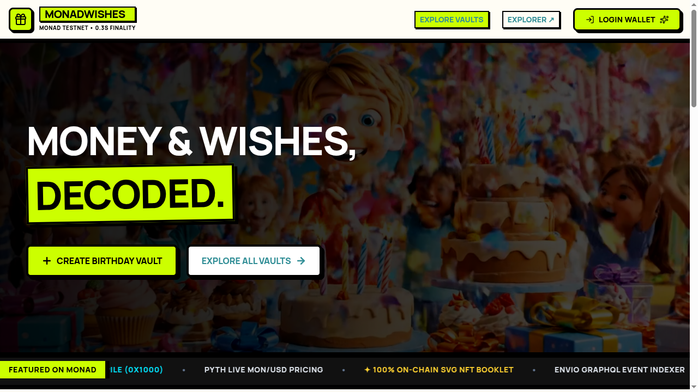

# 🎉 MonadWishes — Social Birthday Gift Vault & Yield Pool on Monad Blockchain

[](https://testnet.monadexplorer.com)
[](https://monadwishes.rahmateka.my.id/)
[](https://soliditylang.org/)
[](https://envio.dev)
[](https://pyth.network)

> **MonadWishes** is a decentralized, time-locked social birthday gift vault and yield-generating pool built natively on the **Monad Blockchain**. Friends & family contribute **MON** tokens along with personalized greetings. While locked, contributions are deployed into Monad's native staking protocol to generate yield. On the recipient's birthday, the pool unlocks, transferring accumulated MON + yield and minting a **Dynamic 100% On-Chain SVG NFT Gift Booklet**.

---



## 🌐 Live Application & Links

- **🚀 Live Web App**: [https://monadwishes.rahmateka.my.id/](https://monadwishes.rahmateka.my.id/)
- **📜 Vault Smart Contract (Monad Testnet)**: [`0xd3146Aabe8a4f50426d0d12A67ecca0ebEB06764`](https://testnet.monadexplorer.com/address/0xd3146Aabe8a4f50426d0d12A67ecca0ebEB06764)
- **🎨 NFT Booklet Contract (Monad Testnet)**: [`0x80994d808075041964605fCA72E7858b861c2c01`](https://testnet.monadexplorer.com/address/0x80994d808075041964605fCA72E7858b861c2c01)

---

## 🔥 Key Innovation & Outstanding Monad Features

### 1. ⚡ Exploiting Monad's 0.3s Block Time & Sub-Second Finality
Monad's high-throughput parallel execution engine provides **0.3-second block time** and instant finality. MonadWishes leverages this speed to deliver real-time contribution feedback, instant wish wall updates, and sub-second transaction mining toasts.

### 2. 🥩 Monad Native Staking Precompile Integration (`0x1000`)
> **Status:** real delegation is not live yet. The vault calls the staking precompile at `0x0000000000000000000000000000000000001000` but sends no MON, so contributions stay in the vault.

The yield shown today is a bonus of 0.5% per 30 days, counted up to the birthday and paid from a protocol reserve (MON sent straight to the vault contract). When the reserve is empty the recipient still gets the full principal.

### 3. 🎨 Dynamic 100% On-Chain SVG NFT Booklet
When the birthday recipient releases their gift, the contract automatically mints a **Monad Birthday Gift NFT Booklet**. The metadata and visual vector graphics are generated **100% on-chain** in pure Solidity string formatting—storing the recipient's name, total MON collected, total greetings count, and yield generated without external IPFS dependencies.

### 4. 🔮 Pyth Network Live MON/USD Price Feed
MON/USD comes from the Pyth contract on Monad Testnet (`0x2880aB155794e7179c9eE2e38200202908C17B43`), read with `getPriceUnsafe`. The public Hermes API now needs an API key. The on-chain price only moves when someone pushes an update, so the UI shows its age when it is more than an hour old.

### 5. 📊 Real-Time Envio HyperIndex GraphQL Indexer
The `indexer/` folder holds an **Envio HyperIndex** indexer for `VaultCreated`, `ContributionReceived` and `GiftClaimed`. It is optional: set `VITE_INDEXER_GRAPHQL_URL` to use it. Without it, or when it fails, the app reads every vault from Monad RPC in a single multicall.

### 6. 🔐 Privy Embedded MPC Wallet & Social Login
Users can log in seamlessly using **Google, Twitter, Email, or Passkeys** via Privy Embedded MPC Wallets, or connect external EVM wallets (MetaMask, Phantom, Coinbase Wallet).

---

## 🏛️ Smart Contract Architecture

```
                       ┌──────────────────────────────────────────┐
                       │           MonadBirthdayVault             │
                       │ 0xd3146Aabe8a4f50426d0d12A67ecca0ebEB06764 │
                       └────────────────────┬─────────────────────┘
                                            │
           ┌────────────────────────────────┼────────────────────────────────┐
           │                                │                                │
           ▼                                ▼                                ▼
┌─────────────────────┐          ┌──────────────────────┐        ┌──────────────────────┐
│  Monad Staking      │          │  MonadBirthdayNFT    │        │  Pyth Network Oracle │
│  Precompile (0x1000)│          │  (On-Chain SVG)      │        │  (HERMES Price Feed) │
└─────────────────────┘          └──────────────────────┘        └──────────────────────┘
```

### Core Functions

- `createVault(address _recipient, string _recipientName, uint256 _durationInDays, uint256 _targetAmount)`: Deploys a new time-locked birthday vault pool.
- `contribute(uint256 _vaultId, string _message)`: Accepts MON contribution + wish message, updates vault principal, and stakes into Monad Precompile `0x1000`.
- `releaseBirthdayGift(uint256 _vaultId, bool _isDemoMode)`: Unlocks the pool on or after the birthday, adds the yield bonus the reserve can cover, transfers MON to the recipient, and mints the On-Chain SVG NFT Booklet. Anyone can call it after the birthday. Demo mode lets the creator, recipient or owner release early.
- `setDemoMode(bool _enabled)`: Owner switch for demo release. Turn it off for any real use.

---

## 🛠️ Project Structure

```
MonadWishes/
├── contracts/                  # Solidity Smart Contracts (Foundry)
│   ├── src/
│   │   ├── MonadBirthdayVault.sol  # Main Time-Locked Vault & Yield Pool
│   │   └── MonadBirthdayNFT.sol    # Dynamic On-Chain SVG NFT Booklet
│   ├── script/
│   │   └── Deploy.s.sol            # Monad Testnet Deployment Script
│   └── test/
│       └── MonadBirthdayVault.t.sol# Comprehensive Foundry Test Suite
├── indexer/                    # Envio HyperIndex GraphQL Indexer
│   ├── config.yaml             # Envio Monad Testnet Event Schema
│   └── schema.graphql          # Vault & Greeting Data Entities
├── frontend/                   # React + Vite Web Application
│   ├── src/
│   │   ├── components/         # Neo-Brutalist UI Components & Modals
│   │   ├── config/monad.ts     # Monad Testnet chain, RPC client & addresses
│   │   ├── hooks/
│   │   │   ├── useVaultClient.ts# Unified Web3 & Vault Transaction Client
│   │   │   └── usePythPrice.ts  # Shared on-chain Pyth MON/USD reader
│   │   ├── routes/index.tsx    # App Dashboard & Vault Feed
│   │   └── services/indexer.ts # Envio GraphQL & RPC Fallback Client
└── README.md
```

---

## ⚡ Local Setup & Development

### Prerequisites

- [Node.js](https://nodejs.org/) v18+
- [Bun](https://bun.sh/) or `npm` / `pnpm`
- [Foundry](https://getfoundry.sh/) (for smart contract testing & deployment)

### 1. Clone & Install Dependencies

```bash
git clone --recursive https://github.com/rhmatzeka/MonadWishes.git
cd MonadWishes/frontend
bun install
```

### 2. Configure Environment Variables

Create `.env.local` inside `frontend/`:

```env
VITE_PRIVY_APP_ID=your-privy-app-id
VITE_VAULT_ADDRESS=0xd3146Aabe8a4f50426d0d12A67ecca0ebEB06764
VITE_NFT_ADDRESS=0x80994d808075041964605fCA72E7858b861c2c01
# Optional
# VITE_INDEXER_GRAPHQL_URL=https://your-indexer/v1/graphql
```

### 3. Run Frontend Locally

```bash
bun dev
```

Open `http://localhost:3000` in your browser.

---

## 🧪 Smart Contract Verification & Testing (Foundry)

```bash
cd contracts
forge test -vvv        # contract tests
cd ../frontend
bun test src           # frontend unit tests
```

### Deploying to Monad Testnet

```bash
forge script script/Deploy.s.sol:DeployMonadWishes \
  --rpc-url https://testnet-rpc.monad.xyz \
  --broadcast \
  --legacy
```

---

## 🎯 Hackathon Highlights

- **Built For Monad**: Built from the ground up for Monad's EVM execution engine, leveraging native precompiles and 0.3s block speed.
- **Real Use Case**: Solves group birthday gifting by combining pool funding, yield generation, social greetings, and collectible digital memories.
- **Live on Testnet**: Deployed on Monad Testnet and Vercel.

---

## 📄 License

MIT License © 2026 MonadWishes Team
